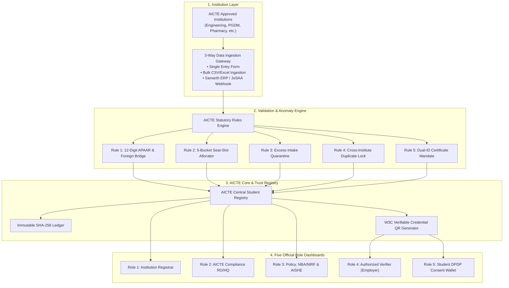

# APAAR-Setu — AICTE National Unified Student Registry & Verification Portal

[](https://www.sih.gov.in/)
[](https://www.sih.gov.in/)
[](https://aicte-india.org)
[](https://guidelines.india.gov.in/)

> **Official Submission for Smart India Hackathon 2026**  
> **Problem Statement ID**: `26063`  
> **Ministry / Organization**: All India Council for Technical Education (AICTE), Ministry of Education, Government of India  
> **Project Name**: **APAAR-Setu (अपार सेतु)**  
> **Title**: Integrated APAAR-based Student Data Management and Verification System  

---

## 🌐 Live Interactive Portal Services

- 🚀 **Frontend Web Application**: `http://localhost:5173` (Vite + React 19 + TypeScript + Tailwind CSS GIGW 3.0)
- 🚀 **Backend REST API & Swagger**: `http://localhost:8000/docs` (FastAPI + Pydantic v2 + Statutory Rules Engine)
- ⛓️ **Cryptographic Ledger**: SHA-256 Merkle Hash-Chain + Ed25519 CCA eSign Standard

---

## 📌 Executive Summary & Problem Context

AICTE currently receives student-related information through disjointed submission mechanisms:
* **PGDM Institutions** submit granular student-level data annually.
* **Other AICTE-Approved Institutions** primarily provide aggregated statistical information (such as total enrolment) during the annual Approval Process Handbook (APH) approval cycle.

This creates critical systemic vulnerabilities:
1. **Seat Ghosting & Over-Admissions**: Institutions admitting beyond approved ceilings (both regular intake and supernumerary quotas like TFW, EWS, NRI, FN/OCI, PMSSS).
2. **Multi-Institution Double Enrolment**: Students securing or blocking seats in two full-time institutions simultaneously without central detection.
3. **Credential Forgery & Verifiability Deficit**: Lack of a cryptographically verifiable connection between institutional student IDs, university degrees, and the **Automated Permanent Academic Account Registry (APAAR ID)** — the national academic identifier under NEP 2020.
4. **Accreditation & Policy Blindspots**: Incomplete student cohort tracking impairs NIRF ranking, NBA/NAAC audits, and national retention/diversity policy forecasting.

---

## 🏛️ System Architecture Workflow



---

## 🛡️ The 10 Statutory AICTE & APAAR Rules Enforced

1. **RULE 1 (12-Digit APAAR & Provisional Foreign Bridge):** Standard Indian students must have a 12-digit numeric APAAR ID verified against DigiLocker NAD and Verhoeff checksum. Foreign Nationals (Study in India) and OCI students exempt from Aadhaar are issued cryptographically bound Provisional Foreign APAAR IDs (`APAAR-FN-2026-XXXX`).
2. **RULE 2 (5-Bucket Statutory Seat-Slot Allocator):**
   - `REGULAR_MERIT` (Open, SC, ST, OBC, EWS — capped at `Approved Intake - NRI Enrolled`).
   - `NRI_QUOTA_5PCT` (Up to 5% within Approved Intake — ONLY if `eoa_nri_approved == True`).
   - `SUPERNUMERARY_TFW_5PCT` (Up to 5% over and above Approved Intake).
   - `SUPERNUMERARY_FN_OCI_15PCT` (Up to 15% over and above Approved Intake).
   - `SUPERNUMERARY_PMSSS` (Over and above intake for J&K/Ladakh central allotment holders).
3. **RULE 3 (Excess Enrolment Quarantine):** Any candidate admitted beyond sanctioned bucket capacity is automatically marked `BLOCKED_EXCESS_INTAKE` (e.g. `Seat 121 of 120`).
4. **RULE 4 (Cross-Institution Duplicate Lock + AI Fuzzy Linkage):** Real-time lock prevents any APAAR ID from being actively enrolled in two AICTE institutions simultaneously across India. Includes demographic fingerprinting (`match_confidence > 94%`) to detect students admitted under slight name spelling variations.
5. **RULE 5 (Dual-ID Degree Certificate Mandate — Key Requirement #10):** Official degrees and transcripts visibly display and cryptographically bind **both** the National APAAR ID and the Institutional Student Roll ID, plus the assigned AICTE Sanctioned Seat Slot ID.

---

## ⚡ Quick Start & Execution

### Prerequisites
* Python 3.10+
* Node.js 18+ & npm

### Starting the Services

```bash
# 1. Start Backend API (FastAPI)
backend/venv/bin/uvicorn backend.app.main:app --host 0.0.0.0 --port 8000

# 2. Start Frontend UI (Vite + React)
cd frontend
npm install
npm run dev
```

Visit **`http://localhost:5173`** in your browser.

---

## 🎬 6 Pre-Seeded SIH Video Demo Scenarios

Use the persistent **SIH Demo Scenarios** dropdown in the top-right bar to trigger test cases in 1-click:
1. **Scenario 1: Clean Batch Admission Sync (MAIT Delhi)** — 120 sanctioned seats, valid 12-digit APAARs, regular and TFW slots.
2. **Scenario 2: Cross-College Duplicate APAAR Lock** — Horizon Pune attempts to enroll student with APAAR already locked at MAIT Delhi.
3. **Scenario 3: Excess Admission Intake Breach (Apex PGDM)** — Admitting student 61 of 60 triggers immediate statutory quarantine.
4. **Scenario 4: Unapproved NRI Quota Violation** — College without EoA approval admitting under NRI quota blocked.
5. **Scenario 5: Foreign National (SII) & Provisional APAAR** — Study in India student from Nepal/Kenya verified via passport and e-FRRO visa.
6. **Scenario 6: Dual-ID Certificate & DPDP Consent** — Employer instant QR verification and student 24h consent approval/revocation.
